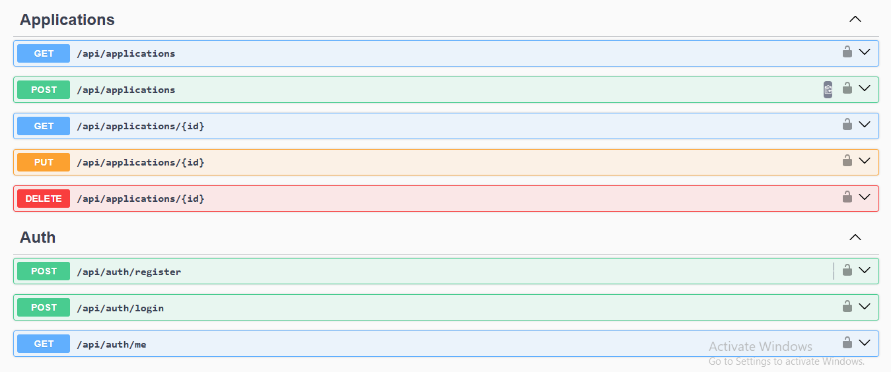

# JobTrack API

A REST API for tracking job applications. Users sign up, log in, and manage their own applications as they move from **Applied** to **Interview** to **Offer** or **Rejected**.

Built with **ASP.NET Core (.NET 10)**, **Entity Framework Core**, **JWT authentication**, and **xUnit** integration tests.

## Live demo

- **App:** https://jobtrack-web-gamma.vercel.app
- **API docs (Swagger):** https://jobtrack-api-cmqo.onrender.com/swagger
- **Front end repo:** https://github.com/daniahaitham/jobtrack-web

> The API runs on a free plan and sleeps when nobody uses it, so the **first load can take about a minute**. After that it's fast.

Hosted on Render (API, in Docker), Neon (PostgreSQL) and Vercel (React).

## API docs



## Features

- Register and log in (passwords are hashed with PBKDF2, never stored in plain text)
- JWT tokens protect all application endpoints
- Full CRUD for job applications (company, role, link, status, dates, notes)
- Each user can only see and change **their own** data
- Input validation with clear `400` error responses
- Interactive API docs with Swagger
- Automated tests (unit + end-to-end) and a GitHub Actions CI pipeline

## Tech stack

| Part | Choice |
|---|---|
| Framework | ASP.NET Core Web API (controllers), .NET 10 |
| Database | PostgreSQL (Neon) online, SQLite locally, via Entity Framework Core  |
| Auth | JWT bearer tokens |
| Docs | Swagger / OpenAPI (Swashbuckle) |
| Tests | xUnit + `WebApplicationFactory` |
| CI | GitHub Actions |

## Run it locally

You need the [.NET 10 SDK](https://dotnet.microsoft.com/download) (check with `dotnet --version`).

```bash
git clone https://github.com/daniahaitham/jobtrack-api.git
cd jobtrack-api
dotnet run --project src/JobTrack.Api
```

The browser opens **http://localhost:5080/swagger**. To try a protected endpoint:

1. `POST /api/auth/register` with an email and a password (8+ characters)
2. Copy the `token` from the response
3. Click **Authorize** (top right), paste the token, and try `/api/applications`

A `jobtrack.db` file is created on first run. It is ignored by Git.

### Or with curl

```bash
# 1. Register (the response contains a token)
curl -X POST http://localhost:5080/api/auth/register \
  -H "Content-Type: application/json" \
  -d '{"email":"me@example.com","password":"password123"}'

# 2. Create an application (replace TOKEN)
curl -X POST http://localhost:5080/api/applications \
  -H "Authorization: Bearer TOKEN" \
  -H "Content-Type: application/json" \
  -d '{"company":"Acme","role":"Junior Developer","status":"Applied"}'

# 3. List my applications
curl http://localhost:5080/api/applications -H "Authorization: Bearer TOKEN"
```

## Endpoints

| Method | URL | Auth | Description |
|---|---|---|---|
| POST | `/api/auth/register` | no | Create an account, returns a token |
| POST | `/api/auth/login` | no | Log in, returns a token |
| GET | `/api/auth/me` | yes | Who am I? |
| GET | `/api/applications` | yes | List my applications (newest first) |
| GET | `/api/applications/{id}` | yes | Get one application |
| POST | `/api/applications` | yes | Create an application |
| PUT | `/api/applications/{id}` | yes | Update an application |
| DELETE | `/api/applications/{id}` | yes | Delete an application |

Status values: `Applied`, `Interview`, `Offer`, `Rejected`.

## Run the tests

```bash
dotnet test
```

- `PasswordServiceTests`: hashing and verification
- `ApiTests`: starts the real API in memory (with a temporary database) and checks register, login, CRUD, validation, and that one user can't touch another user's data

## Project structure

```
src/JobTrack.Api/
  Controllers/   HTTP endpoints (Auth, Applications)
  Data/          EF Core DbContext (tables and rules)
  Dtos/          Shapes of the JSON going in and out
  Models/        Database classes (User, JobApplication, ApplicationStatus)
  Services/      Password hashing and JWT creation
  Program.cs     App setup (database, auth, Swagger)
tests/JobTrack.Tests/
```

## Configuration

| Setting | Where | Notes |
|---|---|---|
| `ConnectionStrings:Default` | `appsettings.json` | SQLite file by default |
| `Jwt:Key` | `appsettings.Development.json` (dev only) | **Production:** set the environment variable `Jwt__Key` to a long random secret (32+ characters) |
| `Jwt:ExpiryMinutes` | `appsettings.json` | Token lifetime, default 120 |

The key in `appsettings.Development.json` is a dummy value for local use only. Real secrets are never committed.

## Design decisions

- **User id comes from the token, not the request.** Every query filters by the logged-in user, so there is no way to read someone else's data by guessing ids (it returns `404`).
- **Same error for "unknown email" and "wrong password"** so attackers can't discover which emails are registered.
- **DTOs instead of exposing database classes**, so fields like the password hash can never leak.
- **PBKDF2 with a random salt and fixed-time comparison** from the .NET standard library.

## Roadmap

- [ ] Search, filter by status, and pagination
- [ ] Follow-up reminders (due today / overdue)
- [ ] Stats endpoint (applications per status and per week)
- [ ] EF Core migrations and PostgreSQL
- [ ] Dockerfile and docker-compose
- [ ] Deploy the API online
- [ ] `jobtrack-web`: React front end

## Author

Dania Haitham, [github.com/daniahaitham](https://github.com/daniahaitham)
